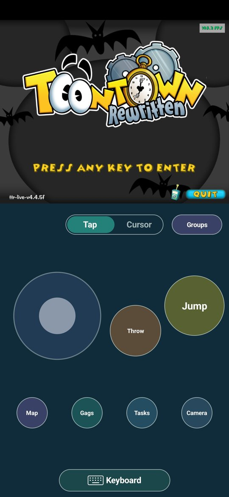
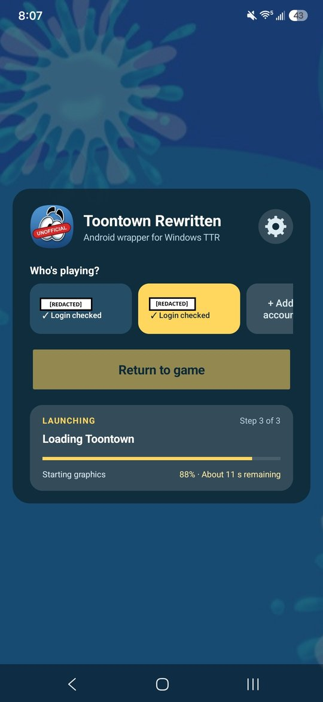
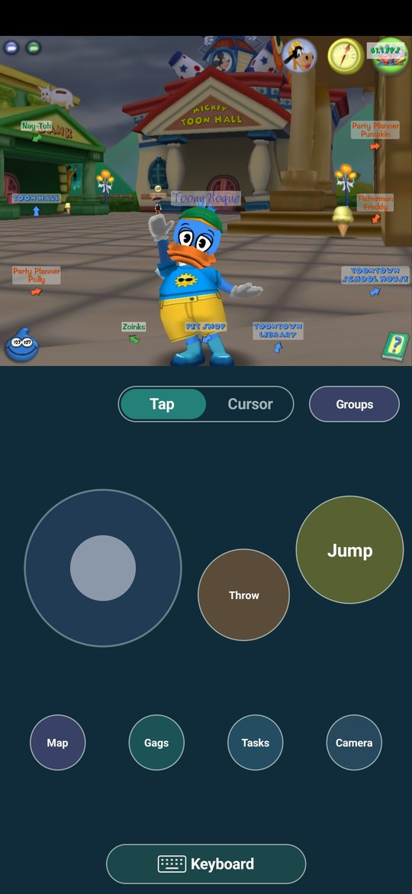
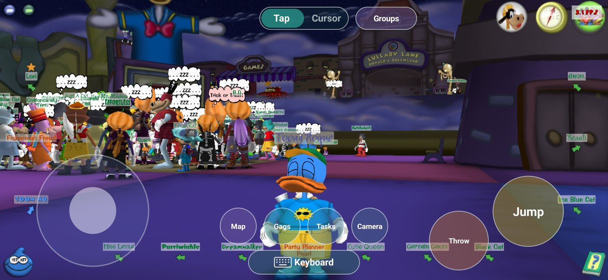

# TTR Mobile

An unofficial Android app for playing [Toontown Rewritten](https://www.toontownrewritten.com) on a phone. It runs
TTR's unedited Windows game client through Wine and FEX-Emu, with touch controls and a custom launcher with no complex setup required.

IPhone and iOS is currently not supported as this type of instruction translation requires JIT compilation which is blocked on iOS devices. 

TTR Mobile is not made or supported by the Toontown Rewritten
team.

## What it does

- Logs in with your TTR account (saved encrypted on the phone).
- Downloads and updates the game files from TTR's servers.
- Runs the Windows game in a private X server inside the app, with two graphics paths: faster (OpenGL on
  Vulkan, Mesa zink) and compatibility (GL4ES). Automatic mode switches to compatibility if the faster path fails.
- Touch controls for portrait (game on top, controls below) and landscape (controls over the game).
- Game controller support (Xbox layout)

Needs Android 10 or newer on a 64-bit ARM phone. The first start downloads the Windows runtime
and the game.

## Download

Get the APK from the [latest release](https://github.com/zahidul23/ttr-mobile/releases/latest), open it on your
phone (allow installs when Android asks), then sign in with your TTR account. New versions install over the old
one and keep your saved accounts.

## Screenshots

  
  &nbsp;
  
  &nbsp;
  

  

## Performance

The game is very playable on modern mid-high end devices, preferably on Snapdragon processors with Adreno GPUs from the last 4 years. Phones with lower end processors such as the MediaTek shown in the table below will likely perform poorly but still remain somewhat playable.

May experience some FPS drops in largely crowded areas even on high end devices.

| Phone | Processor | GPU | Graphics mode | Average FPS (Toontown Central) |
|---|---|---|---|---|
| Samsung Galaxy S23 | Snapdragon 8 Gen 2 for Galaxy | Adreno 740 | Compatibility (GL4ES) | 45-60 |
| Moto G Stylus 5G (2023) | Snapdragon 6 Gen 1 | Adreno 710 | Compatibility (GL4ES) | 27-28 |
| Moto G Power 5G (2024) | MediaTek Dimensity 7020 | PowerVR BXM-8-256 | Faster (Vulkan, zink) | 14-25 |

## You don't need this app to play TTR on your phone

Windows game apps such as [BannerHub](https://github.com/The412Banner/bannerhub) already run TTR's official
launcher and game on Android; TTR Mobile is built on the same kind of runtime (Wine and FEX-Emu). What it adds is a
setup made only for TTR: its own login screen, game updates, controls and graphics settings tuned for the game, in
one app with nothing to configure. 

Because it only carries what TTR needs, it only takes about 1.5 GB of storage
with the game installed, compared with 7 GB or more for a BannerHub setup.

Already using BannerHub? You can get this app's landscape controls there too: import
[`configs/ttr-mobile-controls.icp`](configs/ttr-mobile-controls.icp) as a controls profile (steps in
[`configs/INSTALL.md`](configs/INSTALL.md)).

## AI Disclosure

Most of this project's code, build scripts and documentation were written with AI assistance (OpenAI's GPT models
and Anthropic's Claude), directed by the maintainer. Changes
are built and tested on real phones before release.

## How it works

1. **Launcher** (Java, `app/src/org/ttrmobile/`): login, accounts, game file updates, settings.
2. **Windows runtime** (`TtrWineRuntime`, `TtrRuntime`): on first start the app downloads pinned builds of
   GameNative's Proton (Wine for ARM64EC) and FEX-Emu, then starts Wine with `TtrBootstrap.exe`
   (`windows/bootstrap.c`), which starts the game with the login session.
3. **Display**: a Termux:X11 server (`com.termux.x11.LorieView`, native `libXlorie.so`) runs in the app; the game
   draws to it through GL4ES or Mesa zink.
4. **Controls** (`TtrTouchControls`, `TtrControlLayout`): touch input becomes TTR's keyboard keys and mouse clicks.

## Building

Windows 10 or 11 with:

- Python 3.12+, with Pillow (`pip install pillow`)
- Git for Windows (its `patch.exe` is used), CMake and Ninja on `PATH`
- WSL with Ubuntu 24.04, for the Vulkan graphics stack

Then:

    python tools/bootstrap.py           # JDK, Android SDK and NDK, Zig, 7-Zip and pinned sources into .tools
    wsl bash tools/vulkan_stack/build.sh  # Mesa zink + Vulkan loader → build/vulkan-stack (see below)
    python tools/test.py                # host tests
    python tools/build_app.py --dev-server http://<your PC>:8765   # test build, signed with a local key
    python tools/build_app.py           # release build, signed with your key (docs/release-signing.md)

`build_app.py` builds whatever native pieces are missing (X server, X11 libraries, GL4ES, bzip2, keyboard maps,
the Windows bootstrap, and the logo and icon extracted from TTR's official installer). APKs go to `dist/`.

**Vulkan stack (one-time WSL setup):** the script expects Android NDK r28c for Linux unpacked at
`/opt/ttrbuild/android-ndk-r28c` and Meson 1.12 in a virtualenv at `/opt/mesonenv` (with `mako` and `pyyaml`),
plus Ubuntu's build tools (`build-essential cmake ninja-build pkg-config python3-venv bison flex glslang-tools
wget zstd`). Run it after `bootstrap.py` and `build_x11_libraries.py`, since Mesa links against the app's X11
libraries. Set `WORK=` to use another folder than `/opt/ttrbuild`.

**Test builds** (`--dev-server`) are a separate app, "TTR Mobile Dev". Run `python tools/dev_server.py` on the
same network: the app sends its logs there and offers newer test builds automatically.

## Repository

| Path | What |
|---|---|
| `app/` | Android app: manifest, Java sources, native helpers (`app/native/`) |
| `native/bzip2/` | bzip2 and its JNI binding |
| `windows/bootstrap.c` | small Windows program that starts the game inside Wine |
| `tools/` | build scripts, pinned sources (`sources.json`), test server |
| `tests/` | host tests |
| `configs/` | BannerHub controls profile |
| `docs/` | signing and package notes, README screenshots |

## License

GPL-3.0 (see `LICENSE`); third-party components and their licenses are listed in `NOTICE.md`. Toontown Rewritten's
game, name, logo and artwork belong to their owners; apart from the screenshots in
`docs/screenshots/`, none of it is in this repository.
